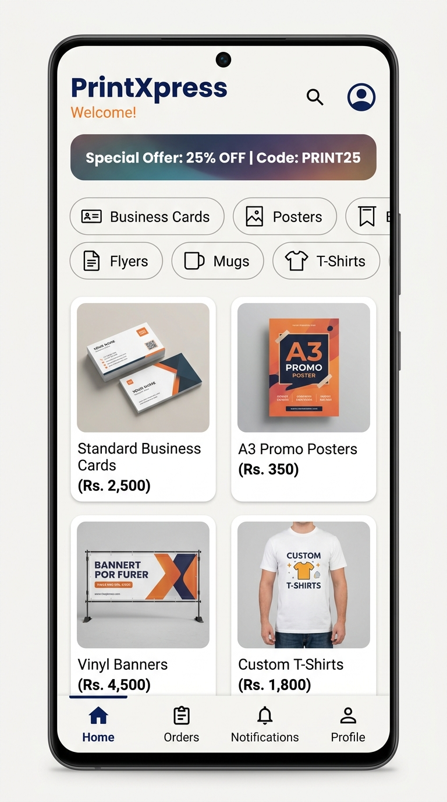

# 🖨️ PrintXpress — Custom Printing Order App

A full-featured Android mobile application for a custom printing service business, built with **Java** and **Firebase**.

<p align="center">
  
</p>

## 📱 Features

- **User Authentication** — Register, Login, Forgot Password (Firebase Auth)
- **Product Catalog** — Browse printing products by category (Business Cards, Posters, Banners, Flyers, Stickers, Mugs, T-Shirts)
- **Product Variants** — Select size, material, and quantity with dynamic pricing
- **Order System** — Upload design files, apply promo codes, choose delivery/pickup
- **Order Tracking** — Real-time status tracking (Pending → Processing → Printing → Ready → Completed)
- **Notifications** — Real-time unread badge count with Firestore snapshot listeners
- **Address Management** — Save, set default, and delete delivery addresses
- **Profile Management** — Edit name, phone, profile picture
- **Admin Panel** — View all orders and support messages
- **Guidelines & FAQ** — In-app help resources

## 🛠️ Tech Stack

| Layer | Technology |
|---|---|
| Language | Java |
| UI | XML Layouts, ViewBinding, Material Design 3 |
| Backend | Firebase Auth, Firestore, Storage |
| Image Loading | Glide, Picasso |
| Architecture | Activity/Fragment pattern |
| Min SDK | 24 (Android 7.0) |
| Target SDK | 34 (Android 14) |

## 🚀 Setup Instructions

### Prerequisites
- Android Studio Hedgehog (2023.1.1) or later
- JDK 8+
- Android SDK 34

### Steps

1. **Clone the repository**
   ```bash
   git clone https://github.com/AjmalRizz/PrintXpress-App.git
   ```

2. **Create Firebase Project**
   - Go to [Firebase Console](https://console.firebase.google.com/)
   - Create a new project
   - Add an Android app with package name: `com.printxpress.app`
   - Download `google-services.json` and place it in the `app/` directory

3. **Configure Admin Credentials**
   - Open `gradle.properties`
   - Set your admin credentials:
     ```properties
     ADMIN_EMAIL=your_admin@example.com
     ADMIN_PASSWORD=your_secure_password
     ```

4. **Enable Firebase Services**
   - Firebase Authentication (Email/Password)
   - Cloud Firestore
   - Firebase Storage

5. **Build & Run**
   - Open the project in Android Studio
   - Sync Gradle
   - Run on emulator or physical device

## 📁 Project Structure

```
app/src/main/java/com/printxpress/app/
├── activities/
│   ├── SplashActivity.java
│   ├── LoginActivity.java
│   ├── RegisterActivity.java
│   ├── MainActivity.java
│   ├── AdminActivity.java
│   ├── ProductListActivity.java
│   ├── ProductDetailActivity.java
│   ├── OrderFormActivity.java
│   └── ...
├── fragments/
│   ├── HomeFragment.java
│   ├── MyOrdersFragment.java
│   ├── NotificationsFragment.java
│   └── ProfileFragment.java
├── adapters/
├── models/
└── utils/
    ├── FirebaseHelper.java
    ├── ValidationHelper.java
    ├── DatabaseSeeder.java
    ├── PriceHelper.java
    └── DateTimeHelper.java
```

## 🔐 Security Notes

- Admin credentials are stored in `gradle.properties` (gitignored), not in source code
- `google-services.json` is excluded from version control — use `google-services.json.example` as a template
- HTTPS enforced (`usesCleartextTraffic="false"`)
- All non-launcher activities are `exported="false"`
- Input validation on all user forms
- File type and size validation on uploads

## 📄 License

This project is open source and available under the [MIT License](LICENSE).

---

Built with ❤️ by **AjmalRizz**

